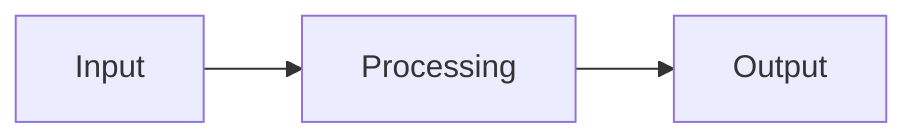

<!--
  Copy this file to projects/<name>.md for a new project, then add a card
  for it in the "Featured projects" table in ../README.md (or move it into
  "Currently building" if it's the active one).
  Banner: change text= and desc= (URL-encode spaces as %20).
-->

  

  
  
  

[← Back to profile](../README.md)

## Overview

What it is, who/what it's for, and the one problem it solves.

## Architecture

## Highlights

- The hardest technical problem and how you solved it
- A safety / security decision you're proud of
- A number: tests, users, uptime, latency

## Results, honestly

What worked, what didn't, and what you decided because of it.

## Tech

`Tool` · `Tool` · `Tool`

## What I learned

-
