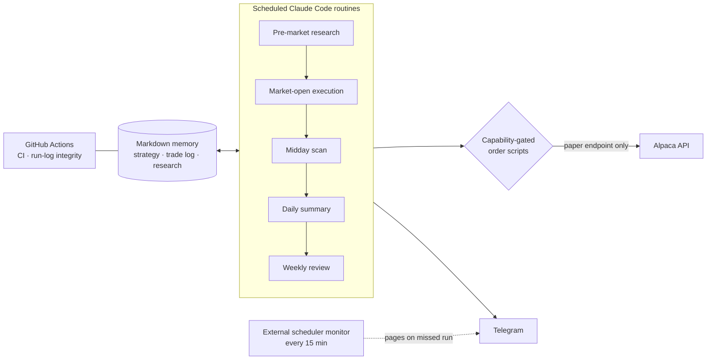

  

  
  
  
  
  

[← Back to profile](../README.md)

## Overview

Captain is a stocks-only, long-only swing-trading agent where **the AI model is the bot** — there is no separate trading process. Five scheduled Claude Code routines run each market day. They read the agent's memory (strategy rules, trade log, research log) from markdown files in the repo, research with Perplexity, place orders through the Alpaca API, and report to Telegram. Every decision and every portfolio snapshot is committed to git.

It started as a 30-day paper-trading challenge against the S&P 500 and a friend's portfolio. It has since become a long-running project focused on one question: **what does it take before an AI agent can be trusted with real money?**

## Architecture

## Highlights

- **Core-satellite portfolio:** an SPY core plus up to 5–6 satellite positions, each passing an entry checklist. Every position has a trailing stop, losers are cut at −7%, and stops tighten as gains grow.
- **Safety layer:** capability-gated order scripts (entry, exit, add-on, stop swap), a HALT kill switch, an equity circuit breaker, idempotent orders, cross-worker locking, crash recovery, and a paper-only endpoint guard enforced in code.
- **Reliability engineering:** every alert path used to live inside the same cloud runs it was monitoring, so a total outage looked exactly like a quiet day. I added an always-on external monitor that pages Telegram when a routine misses its deadline, with a daily heartbeat as a dead-man's switch. I verified it by replaying real past misses.
- **Shadow signals:** candidate strategies are logged but never traded. A four-gate promotion process decides when one can go live, and none have passed so far.
- **CI/CD:** GitHub Actions run tests and a run-log integrity check, and keep the changelog up to date.

## Results, honestly

Over the 30-day challenge Captain finished **about 2 percentage points behind SPY**. It beat the index in some weeks, mostly from a defensive consumer-staples tilt. Two things came out of the post-mortem:

1. "Too few trades" was not a bug. Every rejected candidate had correctly failed the checklist, and backtests confirmed those rejections avoided losing trades.
2. There is **no proven edge** over holding the index. So the mandate changed from "beat SPY" to **reliable, safe benchmark-exposure automation**. Any claim of an edge now needs prospective (forward-looking) evidence first.

## What I'm working on now

A **real-money readiness gate**, the checklist that has to be complete before any funding:

- [x] Scheduler reliability review and external monitor
- [x] Order-lifecycle executor funding gate (built behind a feature flag, currently off)
- [x] Branch protection on the production branch
- [ ] Watched turn-on of the executor
- [ ] Live confirmation of order-path atomicity
- [ ] Real-account position sizing

## Tech

`Claude Code` · `Bash` · `Python` · `Alpaca REST API` · `Perplexity API` · `Telegram Bot API` · `GitHub Actions` · `Windows Task Scheduler` · `WSL`

## What I learned

- Building a strategy is easy. Building the **operational safety** around it (stops, locks, idempotency, monitoring) is most of the work.
- A system that can fail silently will fail silently, so monitoring has to live outside the thing it watches.
- Losing to the benchmark is useful data when you're honest about it.
