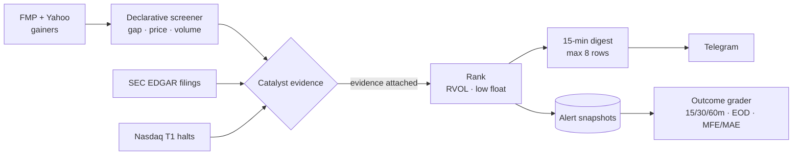

  

  
  
  
  
  

[← Back to profile](../README.md)

## Overview

Everest was a **research analyst, not a trader**. It screened for pre-market and intraday movers, researched why they were moving, and delivered short watchlists to Telegram. It is **read-only by construction**: no broker SDK, no order code, no trading credentials. Its reports could inform a trading system, but a report is never an order.

## Architecture

## Highlights

- **Continuous market monitoring:** a pre-market summary, polling every three minutes, a market-open summary, and an end-of-day stop. All of it is orchestrated from Windows Task Scheduler into WSL, with heartbeat-based cancellation so no orphaned processes are left behind.
- **Evidence-gated alerts:** a ticker is only delivered if it has positive catalyst evidence attached, such as a recent SEC filing (with subject and official link) or an exact Nasdaq T1 halt. Messages say *evidence*, not "proof it caused the move".
- **UX iteration from live data:** the first live session produced 72 names across 26 messages, which nobody could use. I redesigned delivery into one compact digest every 15 minutes, capped at eight rows, with detailed research only on request.
- **Outcome grading:** every alert is snapshotted, then graded at 15, 30 and 60 minutes, end of day, and on max favorable/adverse excursion, which builds an honest track record.
- **Verified indicators:** RSI, EMA, SMA, MACD and Bollinger values were checked against TradingView on real tickers.
- **Backtest engine:** cost models, chronological splits, statistical validation and run cards.
- **486 automated tests**, plus Ruff linting.

## Tech

`Python` · `SEC EDGAR` · `Financial Modeling Prep API` · `Yahoo Finance` · `Telegram Bot API` · `Windows Task Scheduler` · `WSL` · `pytest` · `Ruff`

## What I learned

- Separating research from execution at the code level (not just by policy) makes a system much easier to reason about and to trust.
- Alert fatigue is a real failure mode. A correct alert nobody reads is worth zero.
- Label evidence precisely. Correlation shown in a message should never read as causation.
