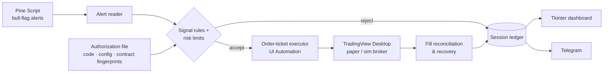

  

  
  
  
  
  

[← Back to profile](../README.md)

## Overview

NightShark was a Windows day-trading bot for **micro index futures** (MES, later MNQ). TradingView had no usable order API for my setup, so NightShark **drove the TradingView Desktop app itself**. It read the screen through the Windows UI Automation accessibility tree, with OCR as a fallback, and placed bracket orders through the real order ticket in paper and simulation accounts.

Signals came from a Pine Script bull-flag indicator I wrote. NightShark read its alerts, validated them against its own copy of the rules, sized the trade, attached a stop and target, and reconciled every fill against its own ledger.

## Architecture

## Highlights

- **Desktop automation as an execution layer:** I built adapters for two broker panels (TradingView Paper and a NinjaTrader simulation account). Each handles different tables, order-ticket layouts and confirmation timing, and every capability was qualified live (place, protect, cancel, close, recover).
- **Fingerprinted authorization:** a standing approval to trade is tied to hashes of the code, config, contract and calendar. Changing any of them voids the approval until a human re-authorizes it. (Lesson learned: git line-ending conversion alone can change those hashes.)
- **Hard risk limits:** per-trade and daily loss caps, a contract cap, an entry backstop, a STOP latch file, and a "never sell what you don't own" rule.
- **Recovery:** after a crash or restart, the session reconciles broker state against its ledger. If history can't be verified, it stops with a clear reason instead of guessing a fill price.
- **Operator dashboard:** a packaged Windows launcher with overview, signal watch, readiness, risk settings, research and live logs.
- **634 automated tests**, plus an offline replay mode that runs the whole pipeline on recorded bars.

## Results, honestly

The execution machinery worked: it qualified live and completed real simulated round trips. The **strategy did not have an edge**. My backtest found none on MES, so the active profile shipped labeled `MECHANICS_ONLY_NO_EDGE`. I archived the project in October 2026 when I dropped the TradingView subscription.

## Tech

`Python 3.13` · `Windows UI Automation (.NET)` · `PowerShell` · `Tkinter` · `Pine Script` · `TradingView` · `NinjaTrader` · `Telegram Bot API` · `pytest` · `Ruff`

## What I learned

- UI automation can be reliable, but only with defensive design: settle waits, focus checks, read-back verification, and refusing to act on stale screens.
- Authorization should be bound to exactly what was reviewed. "Approved" means approved for this code and this config, not in general.
- Proving mechanics and proving profitability are separate milestones.
